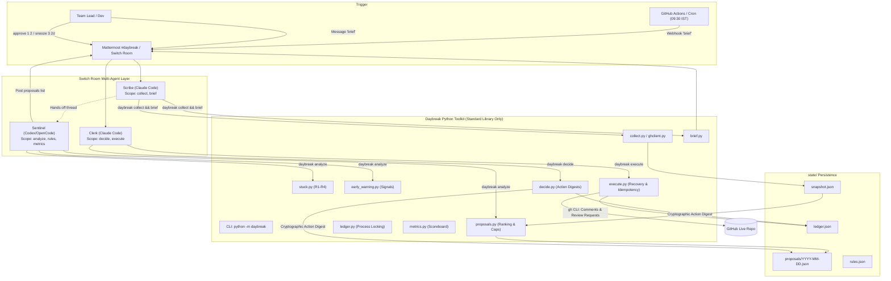

# Daybreak — Standup Zero with Early Warning

> Three AI agents and a deterministic Python toolkit replace the daily standup, surface stuck pull requests, and flag at-risk PRs early — with every outbound action approved by a human.

**Flip the Switch Hackathon · Track 1: Best Business Workflow**

---

## The Problem

Three small frictions repeat every working day:

| Friction | What happens |
| --- | --- |
| **Status theatre** | Updates are typed or spoken even though commits, PRs and issues already hold the facts |
| **Rotting work** | Review requests wait, CI stays red and approved PRs sit unmerged because nobody wants to nag |
| **Tracker drift** | The tracker disagrees with reality because updating it is a second job |

Daybreak turns GitHub activity into an evidence-linked **morning brief**, a short list of **evidence-backed nudges**, and **early flags** for PRs that look likely to stall — all inside the team's chat.

---

## Architecture



### Core Principle: "Code decides, agents explain."

- **Deterministic Python**: Detection, scoring, ranking, deduplication, suppression, quiet hours, and idempotency live in tested Python (standard library only, zero runtime dependencies).
- **Agents**: Scribe, Sentinel, and Clerk read JSON, explain results to humans in chat, and accept human decisions. No agent can alter code, merge PRs, or write to GitHub without recorded human approval.

---

## One-Command Setup

```bash
git clone https://github.com/aditya1981/Flip-the-Switch.git
cd Flip-the-Switch
make setup        # Verifies Python 3.11+, creates .venv, installs pytest, initializes state/
```

### Run Tests
```bash
make test         # 76 tests, 0.08s, fully offline (network calls forbidden by conftest)
```

### Run the Fixture Demo
```bash
make demo         # Complete pipeline on seeded scenarios — no GitHub, no writes
```

---

## Running in Switch

1. **Open Switch Console**: Launch `/Applications/Switch Console.app`.
2. **Import Room Template**: Go to **File → New from Template**, choose `switch/room-template.yaml`.
3. **Configure Parameters**:
   - `team`: `daybreak`
   - `directory`: Set to the absolute path of this repository checkout so all agents share `state/`.
   - `bridge`: Select your Mattermost bridge.
4. **Agent Roles**:
   - **Scribe** (Claude Code): Handles `collect` and `brief`.
   - **Sentinel** (Codex/OpenCode): Handles `analyze`, `rules show/set`, and `metrics`.
   - **Clerk** (Claude Code): Handles `decide` and `execute`.
5. See [`docs/SWITCH_SETUP.md`](docs/SWITCH_SETUP.md) for the detailed step-by-step checklist.

---

## How a Pending Write is Recovered

Daybreak ensures exactly-once execution safety through write-ahead intent logging and remote marker checks:

1. **Write-Ahead Intent**: Before making any outbound API call to GitHub, `execute.py` records `{"status": "pending"}` in `state/ledger.json`.
2. **HTML Idempotency Marker**: Every comment posted to GitHub embeds a hidden marker: `<!-- daybreak:PROPOSAL_ID -->`.
3. **Remote Recovery**: Before issuing a comment call, Daybreak queries GitHub comments. If the marker is already present (e.g., from an interrupted connection or past partial run), it recovers the existing comment URL without posting a duplicate.
4. **Safe Failure**: If a previous write attempt ended in an uncertain state and no remote marker is found, Daybreak stops and prompts for human inspection rather than risking a duplicate comment.

---

## Limitations Stated Honestly

- **Analysis Scenarios**: Complex temporal scenarios (e.g. "PR waiting 31 hours for review") use deterministic seeded fixtures (`fixtures/snapshot_tuesday.json`) because real GitHub timestamps cannot be back-dated. Live GitHub mode verifies the ingestion and write paths.
- **Early-Warning Flags**: Early warning flags are transparent, deterministic heuristics based on observable signals (workload, unassigned reviewer, dependencies); they are not a calibrated ML model or delay probability.
- **Operating System**: Daybreak uses `fcntl.flock` for concurrency safety across agents; it runs on macOS and Linux (not Windows without WSL).
- **Switch Fallback Level Achieved**: Level 2 (single-agent multi-role) and Level 1 (CLI toolkit) are verified. Level 3 (three autonomous agents interacting across threads) has the room template and instruction files prepared, requiring manual verification in the Switch Console GUI.

---

## CLI Reference

Run as `~/.daybreak/bin/daybreak <command>` (or `python -m daybreak <command>`). Global flags work before or after the command.

| Command | Purpose | Output |
| :--- | :--- | :--- |
| `collect [--since auto\|24h\|72h]` | Ingest PRs, issues, commits | `state/snapshot.json` |
| `brief [--since auto\|24h\|72h]` | Group activity per team member | `state/brief.json` and markdown |
| `analyze` | Run stuck rules + early warnings, rank & cap | `state/proposals/DATE.json` and markdown |
| `decide approve N... --by USER` | Approve numbered proposals | Confirmation |
| `decide skip N... --by USER` | Skip proposals (tracks false positives) | Confirmation |
| `decide snooze N --for 1d\|2d\|1w` | Snooze a target | Confirmation |
| `execute [--ignore-quiet-hours]` | Run approved actions on GitHub | Result URLs |
| `rules show` / `rules set K V` | Inspect or modify team rules | Current rules or diff |
| `metrics --week` | Scoreboard comparing baseline & current | Markdown report |
| `demo` | Full fixture demonstration | Transcript |

---

## License

Created for the Flip the Switch Hackathon (Track 1).
