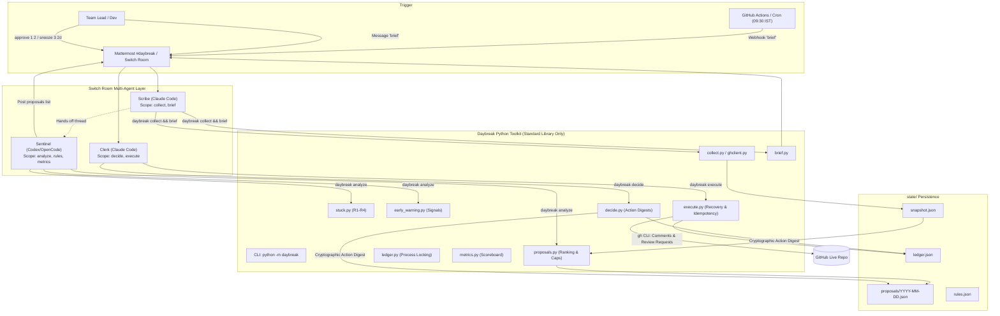

# Daybreak Architecture

## 1. System Overview

Daybreak is a standup-zero workflow automation system designed to eliminate status theatre, surface stuck items, and provide early warning flags for at-risk pull requests. It pairs a deterministic Python standard-library toolkit with three specialized AI agents operating inside a Switch chat room (backed by Mattermost).

### Architectural Axiom
> **"Code decides, agents explain."**
> All detection rules, scoring, ranking, deduplication, suppression, rate-limiting, and idempotency logic run in audited, deterministic Python code. Agents ingest JSON, explain results to humans in chat, and accept human decisions. No outbound action is ever taken without prior human approval recorded in the ledger.



---

## 2. Module Inventory

The entire core runtime is self-contained in `daybreak/` using only the Python standard library.

| Module | LOC | Responsibility | Key Symbols / Classes |
| :--- | :---: | :--- | :--- |
| `daybreak/models.py` | 64 | Atomic file replacement, URL validation, custom exceptions. | `Blocked`, `GitHubError`, `evidence()`, `write_json()` |
| `daybreak/config.py` | 85 | Rules configuration, deep leaf validation, approver authorization. | `validate()`, `authorize()`, `set_rule()` |
| `daybreak/timeutil.py` | 67 | Timezone handling (`Asia/Kolkata` fallback), quiet hours, Friday cutoff, working-day window calculation. | `since()`, `quiet()`, `local_date()` |
| `daybreak/ghclient.py` | 34 | Subprocess wrapper around `gh` CLI. Sanitizes stderr/stdout so tokens and secrets never leak. | `GitHub`, `GitHub.run()`, `GitHub.pages()` |
| `daybreak/collect.py` | 100 | Ingests PRs, issues, commits, and review request timeline events (8-thread worker pool). Limits to 100 items. | `collect()`, `normalize_pr()` |
| `daybreak/brief.py` | 79 | Builds per-person standup brief. Strictly enforces evidence URLs (no link = omitted). | `build()`, `render()` |
| `daybreak/stuck.py` | 59 | Detection of 4 stuck rules: review waiting, CI failure, approved unmerged, stale issue. | `detect()`, `proposal()` |
| `daybreak/early_warning.py` | 62 | Heuristic signals (`no_reviewer`, `workload`, `dependency`) and tiers (`Watch`, `At risk`, `High`). | `detect()` |
| `daybreak/proposals.py` | 66 | Stable daily indexing, ranking, suppression pipeline, and proposal freezing. | `select()`, `rank()` |
| `daybreak/analyze.py` | 69 | Orchestrates stuck + early warning detection, persists proposals, logs budget skips, renders markdown. | `run()`, `render()` |
| `daybreak/decide.py` | 40 | Binds human decisions to immutable SHA-256 proposal action digests. Prevents alteration of executed items. | `decide()`, `digest()` |
| `daybreak/execute.py` | 123 | Executes approved actions. Verifies digests, enforces quiet hours, idempotency markers, write-ahead status, and budgets. | `execute()`, `recovery()`, `perform()` |
| `daybreak/ledger.py` | 31 | Non-blocking inter-process file lock (`fcntl.flock`) and ledger persistence. | `locked()`, `load()` |
| `daybreak/metrics.py` | 101 | Calculates weekly metrics: median first-review wait, stuck items resolved, flag decisions, minutes saved. | `build()`, `render()` |
| `daybreak/cli.py` | 160 | CLI argument parser (supports flexible global flag positioning), execution orchestration, exit code mapping. | `main()`, `options()` |

---

## 3. Proposal Suppression Pipeline & Stable Indexing

To prevent race conditions, duplicate spam, and chat confusion, candidate proposals pass through a deterministic suppression filter:

```
[Candidate Proposals: Stuck (R1-R4) + Early Warnings]
       │
       ▼
1. Is target snoozed? (snooze_until > now) ───────► Suppressed: "snoozed"
       │
       ▼
2. Executed today? (already in ledger) ────────────► Suppressed: "executed_today"
       │
       ▼
3. Skipped today? (in previous batch) ─────────────► Suppressed: "skipped_today"
       │
       ▼
4. Recipient nudge budget exceeded? (>= 2/day) ────► Suppressed: "nudge_budget" (logged to ledger)
       │
       ▼
5. Duplicate target? (keep highest-ranked only) ──► Suppressed: "duplicate_target"
       │
       ▼
6. Exceeds category cap? (max stuck: 4, warn: 2) ──► Suppressed: "suppressed_by_cap"
       │
       ▼
[Selected Proposals] ──► Bind Stable Index (1..N) (Never rebinds existing indices within the day)
```

### Stable Index Binding
- Once a proposal is assigned an index (e.g., `1`), it retains that index for the entire local day, even across re-runs.
- Suppressed or completed items leave tombstones; newly arriving items take `next_index = max(indices) + 1`.
- This ensures that when a human in chat replies `approve 2`, it can never inadvertently approve a different item that shifted position.

---

## 4. Safety & Cryptographic Digest Verification

Daybreak enforces defense-in-depth across the entire action lifecycle:

### 1. SHA-256 Action Digest
When a proposal is approved via `daybreak decide approve N --by USER`, `decide.py` calculates a canonical SHA-256 hash over the proposal's immutable fields:
```python
value = {k: proposal.get(k) for k in ("id", "target", "actions", "repo", "source")}
digest = hashlib.sha256(json.dumps(value, sort_keys=True).encode()).hexdigest()
```
This digest is recorded in `state/ledger.json` alongside the approver identity and timestamp.
At execution time, `execute.py` re-derives the SHA-256 digest from the proposal on disk and validates that:
- An approval decision exists for this proposal ID.
- The recorded digest matches the current proposal content exactly.
If any agent, process, or user tampered with the action text or target parameters after approval, execution is rejected with `Blocked("Approval does not match the action contents")`.

### 2. Hidden HTML Idempotency Markers & Recovery
Every outbound comment created on GitHub ends with a structured HTML comment:
```html
<!-- daybreak:PROPOSAL_ID -->
```
Before executing a write, `execute.py` calls `recovery()`, which queries GitHub for existing comments on that issue or PR. If the marker is already present (e.g., from an earlier network timeout or partial failure), Daybreak recovers the existing comment URL without duplicating the post.

### 3. Write-Ahead Intent Gating
Before issuing an external API call to GitHub, Daybreak persists a `pending` status record into `state/ledger.json`. If the process terminates abruptly or the HTTP connection drops mid-flight, subsequent runs recognize the uncertain state and block automatic re-execution:
`"Previous write has an uncertain outcome; inspect GitHub before retrying"`.

### 4. Process Locking
All state-modifying CLI commands acquire an exclusive, non-blocking lock on `state/.lock` using `fcntl.flock`. If Scribe, Sentinel, or Clerk attempt to run simultaneous mutations, the second agent receives an exit code 3 (`Blocked: Another Daybreak command holds the state lock; retry shortly`).
